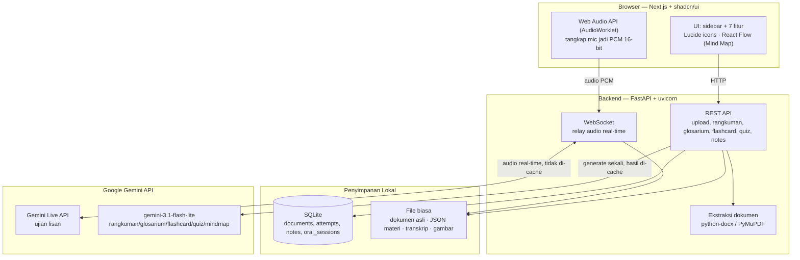
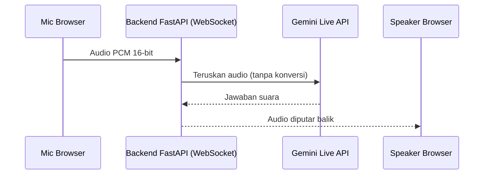

# PRD — Eduviana
**Aplikasi latihan mandiri untuk persiapan sidang skripsi**

Versi: 1.0 · Dokumen internal, untuk penggunaan pribadi (bukan produk komersial)

---
Penting :
fokus pada Planning di projek oram ecam test gemini

## 1. Ringkasan

Eduviana adalah aplikasi web pribadi, dijalankan lokal di komputer sendiri, yang membantu mahasiswa mempersiapkan sidang skripsi dengan cara:

1. Membaca seluruh dokumen skripsi (semua BAB) sekali,
2. Menghasilkan materi belajar otomatis (rangkuman, glosarium, flashcard, quiz, mind map), dan
3. Menyediakan simulasi tanya-jawab lisan real-time dengan AI yang berperan sebagai dosen penguji.

Aplikasi ini **bukan** untuk banyak pengguna — tidak ada login, tidak di-hosting online, dan hanya dipakai oleh satu orang di satu komputer.

## 2. Latar Belakang & Masalah

Mahasiswa yang bersiap sidang skripsi biasanya berlatih dengan cara:
- Membaca ulang draf skripsinya sendiri dari awal,
- Menebak-nebak sendiri kemungkinan pertanyaan dosen penguji,
- Sesekali minta teman/senior berpura-pura jadi penguji (kalau ada yang sempat).

Tidak ada cara yang benar-benar mensimulasikan sesi tanya-jawab lisan sesuai isi skripsi spesifik mahasiswa tersebut, dan tidak ada yang mencatat bagian mana yang masih lemah supaya bisa difokuskan di latihan berikutnya.

## 3. Tujuan

- Mahasiswa bisa berlatih tanya-jawab lisan dengan AI yang benar-benar memahami isi skripsinya sendiri, kapan saja, tanpa bergantung pada orang lain.
- Materi belajar (rangkuman, istilah, flashcard, quiz, mind map) dibuat otomatis dari dokumen skripsi, tanpa perlu disusun manual.
- Aplikasi "ingat" bagian mana yang masih lemah, dan mengarahkan latihan berikutnya ke situ — bukan mengulang yang sudah dikuasai.

### Non-Goals (sengaja tidak dikerjakan)

- Tidak perlu login/akun/multi-user.
- Tidak perlu di-deploy ke internet/cloud — cukup jalan di `localhost`.
- Tidak menggantikan bimbingan dosen — ini alat latihan mandiri, bukan penilai resmi.

## 4. Target Pengguna

**Persona:** Mahasiswa Teknik Komputer, beberapa minggu menjelang sidang skripsi. Sudah pernah berlatih ala kadarnya (baca ulang draf, membayangkan sendiri pertanyaan penguji), tapi belum pernah benar-benar disimulasikan tanya-jawab lisan sesuai isi skripsinya, dan tidak tahu bagian mana yang jawabannya masih lemah.

## 5. Fitur

Diurutkan berdasarkan fase pengerjaan (bukan berdasarkan nomor fitur "asal") — urutan ini penting karena Fase 1 adalah prasyarat mutlak bagi semua fase berikutnya.

### 5.0 Beranda

*(Ditambahkan belakangan — sudah dibangun di FE tapi sempat tidak tercatat di sini. Bukan fase tersendiri: halaman ini cross-cutting, cuma menampilkan agregat dari fitur lain, bukan sumber data utama.)*

Halaman `/` (landing page saat aplikasi dibuka) — tujuannya bikin countdown sidang terasa nyata & memotivasi tiap kali dibuka, bukan sekadar dashboard statistik.

- **Countdown H- ke tanggal sidang**: kartu besar format "H-{n}" + tanggal lengkap, makin dekat hari-H makin "menyala" (warna berubah iris → amber ≤14 hari → merah ≤7 hari).
- **Hitung mundur hidup** (Hari:Jam:Menit:Detik), update tiap detik, tampil sebagai kartu "papan tempel" terpisah dari kartu H- di atasnya.
- **Ringkasan progres**: "{n} dari {total} BAB sudah kamu kuasai" — dihitung dari status kuasai/belajar/belum tiap BAB (lihat `ChapterProgress` di bawah).

**Data yang dibutuhkan (belum ada sumber datanya di section lain di dokumen ini):**
- Tanggal sidang (`SIDANG_DATE`) — di FE sekarang di-hardcode. Perlu diputuskan: input manual dari pengguna (form isi tanggal sidang) atau tetap konstanta yang diedit langsung di kode? Karena aplikasi single-user personal, hardcode/config sederhana kemungkinan cukup, tapi sebaiknya tidak ikut di-generate ulang tiap dokumen di-reupload.
- **Status mastery per BAB** (`kuasai` / `belajar` / `belum`) — dipakai badge status BAB di Beranda & (potensial) sidebar. Belum ada aturan eksplisit di dokumen ini soal kapan sebuah BAB dianggap "kuasai". Diusulkan (perlu dikonfirmasi, bukan keputusan final):
  - `belum`: belum ada aktivitas sama sekali (quiz score 0 dan flashcard mastered 0, belum pernah sesi Ujian Lisan untuk BAB ini).
  - `kuasai`: quiz score ≥ 80 **dan** flashcard mastered/total ≥ 80%.
  - `belajar`: selain dua kondisi di atas (sudah mulai belajar tapi belum "kuasai").
  - Field ini derived (dihitung dari `quiz_attempts` + `flashcard_progress`, lihat `Back End/DATA_MODEL.md`), bukan kolom tersimpan tersendiri.

### Fase 1 — Fondasi (wajib pertama, tanpa ini fitur lain tidak bisa jalan)

**5.1 Manajemen Dokumen Skripsi**
- Upload dokumen skripsi (Word/PDF), seluruh BAB dalam satu file (atau per-BAB, sesuai struktur skripsi).
- Sistem mengingat dokumen yang pernah diupload (riwayat per dokumen) dan otomatis memuat materi milik dokumen yang **terakhir aktif** saat aplikasi dibuka kembali.
- Bila dokumen direvisi: bisa upload ulang versi baru, materi lama (rangkuman/flashcard/quiz/dll) di-generate ulang menggantikan yang lama, tanpa menghapus riwayat progres (skor, catatan sering-salah) kecuali diminta eksplisit.
- Status proses generate ditampilkan (sedang diproses / selesai / gagal).

**5.2 Ujian Lisan (fitur inti)**
- Mic browser merekam suara → dikirim ke backend Python lewat WebSocket → diteruskan ke Gemini Live API → jawaban suara dikirim balik ke browser untuk diputar.
- AI berperan sebagai dosen penguji: system instruction diisi dari isi dokumen skripsi yang sedang aktif, menyapa singkat, mengajukan pertanyaan satu per satu (bukan membacakan ulang isi skripsi), menanggapi jawaban, bertahap dari pertanyaan pemahaman dasar ke pertanyaan analitis/kritis.
- Durasi sesi bisa diatur (misal 20–30 menit) supaya terasa seperti sidang sungguhan yang ada batas waktu.
- Transkrip percakapan (input & output) otomatis tersimpan tiap sesi.
- Di akhir sesi, AI membuat **ringkasan evaluasi** terpisah dari transkrip mentah (kekuatan jawaban, bagian yang masih lemah) — ditampilkan sebagai "rapor singkat", bukan tenggelam di antara transkrip.
- Sesi berikutnya: AI membaca ringkasan evaluasi sesi-sesi sebelumnya, dan **sengaja mengangkat lagi topik yang tercatat masih lemah** — jawaban salah/lemah tidak dilewat begitu saja, tapi diulang di kesempatan berikutnya sampai benar-benar dikuasai.
- *(Opsional, fase mendatang — bukan wajib versi pertama)*: bila sesi terputus tidak sengaja (tab tertutup, koneksi putus), bisa dilanjutkan dari titik terakhir memakai fitur `session_resumption` bawaan Gemini Live API. Ini jaring pengaman jangka pendek (handle berlaku terbatas, bukan penyimpanan permanen), sehingga tidak wajib ada di versi pertama.
- **Sudah ada groundwork di FE** (`Front End/src/hooks/use-mic-level.ts`, dipakai `VoiceOrb`): akses mic (`getUserMedia`) + baca level volume real-time via `AnalyserNode` untuk animasi orb — **bukan** pipeline pengiriman audio ke backend. Saat pipeline sungguhan dibangun, ini perlu **AudioWorklet terpisah** yang capture PCM 16-bit dari stream mic yang sama untuk dikirim ke WebSocket (lihat "Catatan format audio" di section 8) — `AnalyserNode` untuk visual dan `AudioWorklet` untuk data terkirim berjalan berdampingan dari satu `MediaStream` yang sama, bukan saling menggantikan.

### Fase 2 — Materi Belajar Pasif (baca/tinjau)

**5.3 Rangkuman per BAB**

Acuan gaya: hasil percobaan pengguna dengan tool "Maeve" — bukan ringkasan yang dipersingkat drastis, tapi isi BAB ditata ulang jadi rapi & enak dibaca, dengan hampir seluruh detail tetap ada.

- Dipilih per BAB lewat satu pemilih BAB yang dipakai bersama di semua tab (bukan pemilih terpisah tiap fitur).
- Struktur tiap halaman: **Gambaran Singkat** (1 paragraf pembuka) → **Poin Penting** (bullet list) → isi lengkap mengikuti struktur sub-bab asli dokumen.
- **Kotak callout** untuk poin kunci: "🔑 Penting" (highlight kesimpulan/insight penting) dan "📝 Contoh" (highlight contoh konkret) — dipisahkan visual dari teks biasa supaya gampang di-scan cepat.
- **Gambar ditempatkan otomatis di dekat teks yang relevan** (bukan galeri terpisah): saat ekstraksi dokumen, sistem cari teks caption (misal "Gambar 2.1") di dekat gambar aslinya; kalau rangkuman menyebut caption yang sama, gambar itu otomatis disisipkan di situ.
- Kolom catatan pribadi per BAB.

**5.4 Glosarium Istilah**
- Daftar istilah teknis + definisi singkat, dengan pencarian.
- Kolom catatan pribadi per istilah.

**5.5 Mind Map Topik**
- Diagram visual struktur topik & sub-topik per BAB, bisa di-zoom dan dinavigasi.

### Fase 3 — Materi Belajar Aktif (menguji diri sendiri)

**5.6 Flashcard Tanya-Jawab**
- Kartu diklik (atau tekan Spasi) untuk membuka/menutup jawaban, per BAB. Navigasi maju/mundur pakai tombol panah kiri/kanan, dan tombol acak urutan.
- **3 mode belajar** (dropdown, konsep umum ala Anki/Quizlet):
  - **Standar** — flip kartu maju-mundur biasa, tanpa pelacakan benar/salah. Cocok buat pertama kali kenal materi.
  - **Belajar** — ada tombol "✕ Saya tidak tahu" / "✓ Saya tahu" (juga bisa pakai tombol panah atas/bawah). Tiap kartu otomatis masuk ke salah satu dari 3 kategori: **Belum dikenal** (merah) → **Sedang dipelajari** (oranye) → **Dikuasai** (hijau), berdasarkan jawaban berulang. Badge jumlah kartu per kategori ditampilkan di atas. Kartu "Belum dikenal" diprioritaskan lebih sering muncul; yang "Dikuasai" jarang diulang.
  - **Uji** — mode lebih ketat buat simulasi kesiapan, memprioritaskan kartu dari kategori "Belum dikenal"/"Sedang dipelajari" saja.
- Urutan kartu diacak tiap sesi (kecuali sengaja diminta urut).
- Progress kategori (Belum dikenal/Sedang dipelajari/Dikuasai) tersimpan di database, dipakai juga sebagai dasar logic "sering salah" secara umum di aplikasi.

**5.7 Quiz Pilihan Ganda**
- Soal otomatis dari isi skripsi, per BAB, urutan soal diacak tiap sesi.
- Pengguna bisa memilih jumlah soal per sesi (5/10/15/20), dibatasi jumlah soal yang tersedia untuk BAB itu.
- Skor ditampilkan di akhir sesi.
- Sama seperti flashcard: soal yang sering dijawab salah diprioritaskan muncul lagi.
- Layar hasil menampilkan pembahasan per soal: kutipan isi dokumen skripsi pengguna untuk topik itu, plus **verifikasi AI** — kalau dokumen pengguna keliru secara faktual (bukan cuma beda gaya tulisan), ditampilkan sebagai koreksi eksplisit terpisah dari kutipan aslinya (lihat mekanisme `ai_flag`/`koreksi_ai` di `Planning/AI/prompts/quiz.md`).

### 5.8 Jurnal Referensi (memperkaya Quiz & Ujian Lisan)

*(Ditambahkan belakangan — sudah ada UI-nya di FE (`journal-sync-sheet.tsx`, dummy) sebelum tercatat di sini. Cross-cutting seperti Beranda: bukan fase tersendiri, dikerjakan setelah versi dasar Quiz (Fase 3) dan Ujian Lisan (Fase 1) masing-masing sudah jalan — fitur ini memperkaya, bukan prasyarat.)*

- Index PDF jurnal referensi (paper terkait, bukan dokumen skripsi pengguna) dari sebuah folder lokal yang dikonfigurasi pengguna (mis. `D:\Skripsi\Dokumen\Jurnal`) — mirip pola upload dokumen skripsi (5.1), tapi untuk kumpulan paper, bukan satu dokumen.
- Tombol "Sync Jurnal" memindai folder itu, mengekstrak teks jurnal yang belum pernah diindeks (incremental, bukan re-index semua tiap kali), menandai status per file (berhasil / gagal dibaca).
- **Dipakai HANYA di 2 fitur** — Rangkuman, Glosarium, Mind Map, Flashcard **tetap murni** dari isi dokumen skripsi pengguna sendiri, tidak disentuh jurnal referensi:
  - **Quiz (5.7):** soal & pembahasan bisa merujuk perbandingan dengan penelitian terkait dari jurnal terindeks (mis. "bagaimana pendekatan Anda dibanding penelitian X di jurnal Y"), bukan cuma dari isi skripsi sendiri.
  - **Ujian Lisan (5.2):** AI berperan dosen penguji bisa menanyakan perbandingan dengan penelitian terkait/state of the art dari jurnal terindeks — meniru pertanyaan dosen sungguhan soal karya terkait, bukan cuma menguji isi skripsi secara terisolasi.
- Pendekatan teknis: **context stuffing**, bukan RAG/retrieval — lihat `Planning/AI/keputusan-teknik-ai.md` bagian "Pengecualian scope: Jurnal Referensi" untuk alasannya.

## 6. Materi yang Di-generate Sekali vs. Real-time

| Fitur | Sifat | Model AI |
|---|---|---|
| Ujian Lisan | Real-time per sesi, **tidak** di-cache | Gemini Live API |
| Rangkuman, Glosarium, Mind Map, Flashcard, Quiz | Di-generate **sekali** per dokumen, hasil disimpan (cache) — tidak generate ulang tiap buka halaman | Gemini API teks biasa |

## 7. Model AI & Biaya

- **Fitur teks (5.3–5.7):** `gemini-3.1-flash-lite` — dikonfirmasi gratis di free tier Google (dicek langsung di halaman pricing resmi), dan memang ditujukan Google untuk "pemrosesan data sederhana volume rendah" — sesuai persis kebutuhan di sini (~30 request total untuk memproses satu dokumen skripsi lengkap).
- **Fitur suara (5.2):** Gemini Live API — logic koneksinya sudah terbukti berjalan di `live_practice.py` (proyek ini), tinggal diubah transport-nya dari mic/speaker lokal menjadi relay lewat WebSocket browser.
- **Hindari model "Pro"** (gemini-2.5-pro, gemini-3.1-pro, dll) — sejak April 2026 model Pro mewajibkan billing aktif, tidak lagi gratis.
- API key disimpan di file `.env` (sudah ada di proyek ini), **tidak pernah** dikirim ke kode sisi browser — semua panggilan ke Gemini API dilakukan dari backend Python.

## 8. Arsitektur Teknis

**Ringkasan stack (final, tidak berubah lagi kecuali ada alasan kuat):**
- Frontend: **Next.js** + **shadcn/ui** (dibangun di atas **Radix UI**) — direvisi dari React+Vite karena rencana deploy
- Backend: **Python + FastAPI + uvicorn**
- Database: **SQLite**
- Upload & ekstraksi dokumen: **python-multipart, python-docx, PyMuPDF**
- Realtime suara: **WebSocket** (FastAPI) + **Web Audio API/AudioWorklet** (FE)
- Mind Map: **React Flow** (`@xyflow/react`) + **dagre**
- Ikon: **Lucide** (`lucide-react`)
- AI: **Gemini Live API** (suara) + **gemini-3.1-flash-lite** (teks — gratis)
- Deployment: **lokal (`localhost`) saja**, tanpa hosting online

| Layer | Pilihan | Alasan |
|---|---|---|
| Frontend | **Next.js** + **shadcn/ui** (di atas Radix UI) | Direvisi dari React+Vite karena rencana deploy — Next.js lebih standar buat di-deploy (misal ke Vercel), shadcn/ui+Radix UI kasih komponen siap pakai yang gampang dikustom sesuai tema dark+aksen kita |
| Backend | Python + **FastAPI** (bukan Flask/Django) | Native `async`/`await` + WebSocket, cocok dipakai ulang bersama logic `asyncio` yang sudah ada di `live_practice.py` |
| Server ASGI | **uvicorn** | FastAPI cuma kerangka kode — butuh uvicorn buat benar-benar menjalankannya |
| Upload file | **python-multipart** | Wajib buat FastAPI supaya bisa terima file dari form upload; tanpa ini fitur "Upload Skripsi" akan error |
| Ekstraksi teks & gambar dokumen | **python-docx** (untuk `.docx`, teks & gambar tertanam), **PyMuPDF**/`fitz` (untuk `.pdf`, teks & gambar, plus posisi/koordinat gambar per halaman) | Semua fitur bergantung total pada teks skripsi. `PyMuPDF` dipilih (bukan `pypdf`) karena bisa ekstrak gambar & posisinya sekaligus — dibutuhkan untuk menyisipkan gambar otomatis di dekat caption yang relevan pada fitur Rangkuman (5.3) |
| Database | **SQLite** | Bawaan Python (`sqlite3`), tanpa instalasi/server tambahan, cukup untuk skala 1 pengguna |
| Realtime transport | WebSocket (FastAPI) | Menjembatani mic/speaker browser ↔ Gemini Live API, karena API key tidak boleh ada di sisi browser |
| Mind Map | **React Flow** (`@xyflow/react`) + **dagre** (auto-layout) + **expand/collapse custom** | Dagre menghitung otomatis posisi node dari data BAB→topik→sub-topik; React Flow menyediakan interaksi pan/zoom yang matang, plus background dot-grid bawaan. **Dikonfirmasi dari kode aslinya**: aplikasi belajar sejenis (Maeve) memakai library yang sama persis, garis penghubung digambar melengkung (kurva bezier), bukan siku-siku. React Flow **tidak punya** expand/collapse bawaan (beda dari `react-d3-tree` yang sempat dicoba tapi tampilannya kurang bagus) — jadi fitur buka/tutup cabang per node **dibangun manual di atas React Flow**: state menyimpan node mana yang "tertutup", node/edge anaknya disembunyikan dari render sampai diklik lagi |
| Deployment | Lokal (`localhost`) saja | Data skripsi & rekaman suara bersifat pribadi, tidak perlu hosting online |

### Alur data fitur suara

**Catatan format audio (penting untuk koordinasi FE-BE):** FE **wajib** menangkap suara mic memakai Web Audio API (`AudioWorklet`), bukan `MediaRecorder`, supaya audio yang dikirim ke backend sudah berupa **PCM 16-bit mentah** — format yang sama persis dibutuhkan Gemini Live API (sesuai yang sudah terbukti jalan di `live_practice.py`). Dengan ini, backend **tidak perlu** melakukan konversi/transcoding audio apa pun (tidak perlu `pydub`/`ffmpeg`) — tinggal terima & teruskan PCM mentahnya langsung ke Gemini.

### Referensi FE (contoh nyata, bukan sekadar teori)

Aplikasi belajar sejenis **Maeve** ([app.ask-maeve.com](https://app.ask-maeve.com)) dipakai sebagai rujukan visual/teknis untuk beberapa keputusan di atas — bukan untuk ditiru mentah-mentah (Maeve multi-user & berbayar, Eduviana tidak), tapi validasi bahwa pendekatannya terbukti jalan baik di real-world:

- Stack yang dipakai Maeve: Next.js + Tailwind CSS + shadcn/ui (Radix UI) + **Lucide** (ikon — sama seperti pilihan kita) + **React Flow** (`@xyflow/react`) untuk mind map + Supabase (auth & data).
- Tab per dokumen yang mirip struktur Eduviana: Ringkasan, Glosarium, Kartu Flash, Latihan, **Peta Pikiran** — urutan & pengelompokan fitur ini boleh dijadikan referensi tata letak tab/menu.
- Detail teknis Mind Map (orientasi kiri-ke-kanan, kurva bezier, dark + aksen warna) dikonfirmasi langsung dari kode sumber halaman mereka — lihat `WIREFRAMES.md` bagian 5.5 untuk detail lengkap.

**Contoh file nyata** (disimpan di `Planning/referensi-fe/`, sumbernya dari dokumen skripsi yang sama seperti yang dipakai di proyek ini, diproses lewat Maeve):
- `referensi-fe/contoh-rangkuman-maeve.pdf` — contoh hasil fitur Ringkasan Maeve (acuan untuk 5.3 Rangkuman: struktur Gambaran Singkat → Poin Penting → isi lengkap, kotak callout "Penting"/"Contoh", gambar disisipkan di teks).
- `referensi-fe/contoh-mindmap-maeve.pdf` — screenshot tampilan fitur Peta Pikiran Maeve (acuan visual untuk 5.5 Mind Map: warna, gaya kotak node, orientasi kiri-ke-kanan).

### Penyimpanan data

- **File biasa** (bukan database): dokumen skripsi asli yang diupload, hasil generate rangkuman/glosarium/flashcard/quiz/mindmap per dokumen (JSON), transkrip sesi sidang lisan (`.txt`), gambar/diagram hasil ekstraksi per dokumen (posisi & caption-nya dipakai untuk penempatan otomatis di fitur Rangkuman).
- **SQLite** (butuh dilacak/di-query dari waktu ke waktu):
  - `documents` — daftar dokumen yang pernah diupload, mana yang terakhir aktif
  - `quiz_attempts` — riwayat jawaban benar/salah per soal, dipakai untuk logic "sering salah"
  - `flashcard_attempts` — riwayat jawaban per kartu, **termasuk kategori** (Belum dikenal/Sedang dipelajari/Dikuasai) dan mode belajar yang dipakai (Standar/Belajar/Uji)
  - `oral_sessions` — metadata tiap sesi ujian lisan (waktu mulai, durasi, path transkrip, ringkasan evaluasi)
  - `notes` — catatan pribadi per BAB/istilah

## 9. Arah Desain Visual & Navigasi (Frontend)

- **Tema (final):** latar belakang Zinc/Graphite (`#18181B`), warna aksen **Indigo/Violet "Iris"** (`#6E56CF`, skala Radix Colors — nyambung otomatis ke sistem tema shadcn/ui). Dipilih karena biru-ungu paling konsisten dikaitkan riset psikologi warna dengan fokus tenang & kejernihan berpikir (beda dari merah/oranye yang memicu rasa waspada), dan menghindari warna cyan/mint yang juga sudah generik.
- **Navigasi sidebar kiri, persisten** — bukan tab di bagian atas. Tiap menu (Ujian Lisan, **History File**, Rangkuman, Glosarium, Mind Map, Flashcard, Quiz) selalu terlihat dan bisa diklik langsung, tanpa harus bolak-balik ke atas layar.
- **History File di sidebar:** ini label UI untuk fitur Manajemen Dokumen Skripsi (5.1) — berupa grup yang bisa di-expand/collapse, menampilkan jumlah dokumen yang pernah diupload (badge angka) dan daftarnya di bawahnya. Dokumen yang sedang aktif ditandai highlight warna aksen. Daftarnya **fleksibel**, bukan slot tetap satu dokumen.
- **Karakter visual:** satu warna aksen yang berani dipakai *hemat* — untuk item sidebar yang sedang aktif, tombol utama, dan penanda progres/skor — sementara sisanya tenang dan gelap. Kesannya seperti ruang kerja pribadi larut malam: gelap, fokus, tapi ada satu titik warna yang hidup supaya tidak terasa mati/hampa.
- **Tipografi (final):**
  - *Judul/heading/menu*: **Bricolage Grotesque** — bukan Space Grotesk/Inter (itu kombinasi paling klise di produk buatan AI), dipilih karena punya karakter tapi belum jadi pilihan generik semua orang.
  - *Konten paragraf* (Rangkuman/Glosarium/transkrip): **IBM Plex Sans** — sangat mudah dibaca lama, kesan teknikal yang pas buat skripsi Teknik Komputer, satu keluarga sama IBM Plex Mono kalau nanti butuh tampilkan data/kode.
- **Ikon:** pakai [Lucide](https://lucide.dev/icons/) (`lucide-react`) untuk seluruh ikon navigasi & UI sehari-hari — konsisten, ringan, mudah dipadukan dengan dark mode + warna aksen.
- **Halaman Mind Map:** kanvas dengan background dot-grid (bawaan React Flow), bukan versi polos rata seperti default — beri efek *radial fade* ke tepi dan warna dot yang menyatu dengan tema gelap + aksen, supaya terasa modern bukan generik.

## 10. Fase Pengembangan

| Fase | Cakupan |
|---|---|
| **Fase 1** | Upload & kelola dokumen skripsi, riwayat per dokumen; Ujian Lisan (inti: sesi real-time, transkrip, ringkasan evaluasi, callback topik lemah) |
| **Fase 2** | Rangkuman per BAB, Glosarium, Mind Map — semua dengan pemilih BAB bersama & catatan pribadi |
| **Fase 3** | Flashcard & Quiz — termasuk acak urutan dan logic "sering salah" |
| **Fase 4 (opsional, tidak wajib)** | Resume sesi lisan yang terputus lewat `session_resumption` Gemini Live API |
| **Tambahan (setelah Fase 1 & 3 jalan)** | Jurnal Referensi (5.8) — memperkaya Quiz & Ujian Lisan dengan konteks jurnal eksternal |

> Catatan: pada percobaan awal menyusun struktur ini lewat tool eksternal, "Manajemen Dokumen Skripsi" sempat salah ditempatkan di fase terakhir — sudah diperbaiki di sini karena upload dokumen adalah prasyarat mutlak semua fitur lain.

**Penting — urutan pengerjaan FE vs BE:** Frontend (Next.js) dikerjakan **lebih dulu** memakai **data dummy/mock** untuk tiap fitur (bukan menunggu backend FastAPI selesai). Backend dikerjakan menyusul kemudian, lalu data dummy di FE diganti jadi panggilan API sungguhan ke FastAPI. Ini supaya progres tampilan bisa dicek & direvisi lebih awal, tanpa terhambat backend yang belum siap.

## 11. Kriteria Selesai (per fase)

- **Fase 1 selesai** jika: dokumen skripsi bisa diupload, tersimpan, dan langsung bisa dipakai memulai satu sesi Ujian Lisan dari awal sampai muncul ringkasan evaluasi di akhir sesi.
- **Fase 2 selesai** jika: ketiga fitur (Rangkuman, Glosarium, Mind Map) menampilkan hasil generate yang benar per BAB, dengan satu pemilih BAB yang konsisten di semua tab. Khusus Rangkuman: gambar dari dokumen asli berhasil muncul di dekat teks yang relevan (bukan sekadar galeri terpisah), dan kotak callout "Penting"/"Contoh" tampil membedakan diri dari teks biasa.
- **Fase 3 selesai** jika: Flashcard & Quiz bisa dikerjakan penuh satu sesi, skor/hasil tampil, dan soal yang dijawab salah terbukti muncul lebih sering di sesi berikutnya.

## 12. Risiko & Catatan Terbuka

- **Kualitas transkripsi suara** bergantung pada kualitas mic & lingkungan sekitar (bising bisa memengaruhi transkrip).
- **Kuota free tier Gemini** bisa berubah kebijakannya sewaktu-waktu oleh Google — cek berkala di `aistudio.google.com/rate-limit`.
- **Handle `session_resumption`** (bila nanti dipakai di Fase 4) punya masa berlaku terbatas (jam, bukan hari) — bukan penyimpanan permanen.
- Skripsi yang diproses berisi data pribadi/akademik — pastikan folder data & `.env` tidak pernah ter-commit ke repositori publik (`.gitignore` sudah disiapkan di proyek ini).
